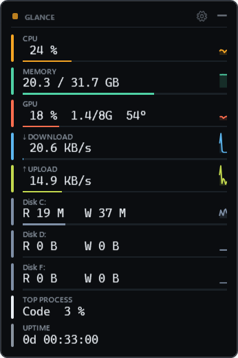
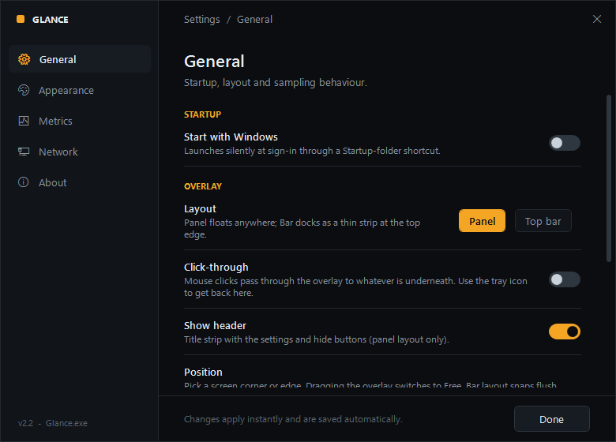
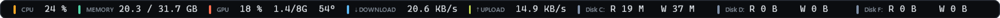
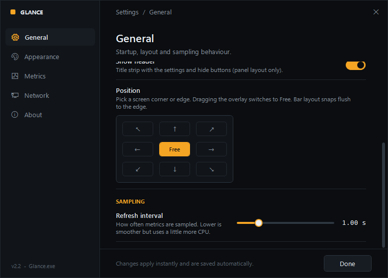
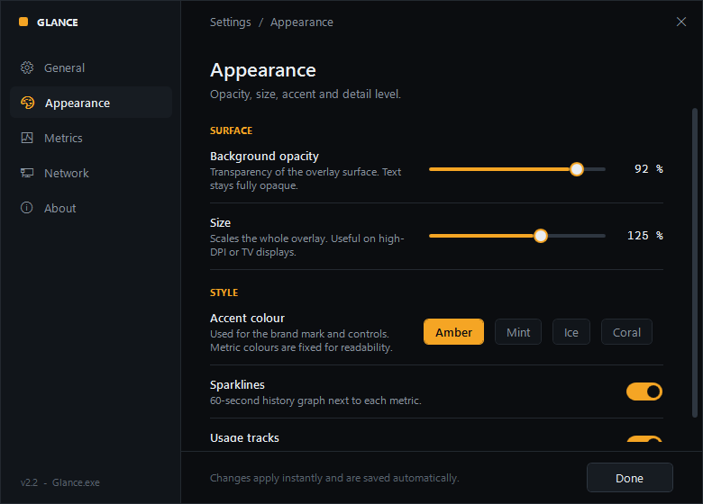

<p align="center">
  
</p>

<h1 align="center">Glance</h1>

<p align="center">
  An always-on-top system monitor for Windows — CPU, memory, GPU, disk and network at a glance.<br>
  One small <code>.exe</code>. No runtime to download, no dependencies, no admin rights.
</p>

<p align="center">
  <a href="../../releases/latest"></a>
  
  
  
</p>

---

## Features

| | |
|---|---|
| **Live metrics, 1 s refresh** | CPU %, RAM used / total, GPU % + VRAM + temperature, download / upload speed, read / write per drive, top process, uptime, battery |
| **Always on top, never in the way** | Borderless, semi-transparent, never steals focus. Optional **click-through** so the mouse goes straight to whatever is underneath |
| **Two layouts** | Floating **panel** with 60-second sparklines and usage tracks, or a slim **bar** docked to the screen edge |
| **Preset positions** | Snap to any corner or edge from a 3×3 picker, or drag it anywhere |
| **Proper settings window** | Startup, layout, opacity, size, accent colour, which metrics to show, which network adapter to measure, bytes or bits |
| **Tray icon** | Left-click to show/hide, double-click for settings, right-click for the menu; tooltip shows current speeds |
| **Zero footprint** | Per-user install in `%LocalAppData%`, listed in *Apps & Features*, clean uninstall. Nothing else is installed |

## Screenshots

<table>
  <tr>
    <td align="center"><br><sub>Panel layout</sub></td>
    <td align="center"><br><sub>Settings — General</sub></td>
  </tr>
  <tr>
    <td colspan="2" align="center"><br><sub>Bar layout, docked to the top edge</sub></td>
  </tr>
  <tr>
    <td align="center"><br><sub>Position presets</sub></td>
    <td align="center"><br><sub>Settings — Appearance</sub></td>
  </tr>
</table>

## Install

1. Download **[Glance-Setup.exe](../../releases/latest)** (or the equivalent `Glance-Setup.cmd` if you prefer a plain script).
2. Run it. It asks whether to start with Windows, then launches Glance in the top-right corner.

> **SmartScreen:** the installer isn't code-signed, so Windows may show *"Windows protected your PC"*. Click **More info → Run anyway**. Everything the installer does is in [`installer/Install.ps1`](installer/Install.ps1).

Silent install for scripts and deployment:

```bat
Glance-Setup.exe /S            :: silent
Glance-Setup.exe /S /STARTUP   :: silent + start with Windows
```

Uninstall from **Settings → Apps**, from Glance's own **Settings → About → Uninstall**, or `"%LocalAppData%\Programs\Glance\Uninstall.cmd" /S`.

## Using it

| Action | How |
|---|---|
| Move | Drag the panel (switches position to *Free*) |
| Settings | Gear icon on the panel · double-click tray icon · tray menu → *Settings…* |
| Show / hide | Left-click the tray icon · the `—` button on the panel |
| Change layout / position / click-through | Tray menu, or Settings → General |
| Quit | Tray menu → *Exit* |

Settings live in `%AppData%\Glance\settings.json` and apply instantly.

### Where the numbers come from

| Metric | Source |
|---|---|
| CPU, RAM, disks | Windows performance counters (locale-independent CIM classes) |
| CPU temperature | ACPI thermal zone — only shown when the firmware exposes one |
| GPU | `nvidia-smi` when present (load, VRAM, temperature); otherwise Windows GPU engine counters |
| Network | Byte counters of every *physical* adapter that is up — virtual adapters (Hyper-V, VMware, VPN) are skipped unless you pick one explicitly |

## How it works

Glance is a WPF application written in PowerShell. `Glance.exe` is a ~85 KB native host that embeds the script and runs it in-process through the Windows PowerShell 5.1 engine that is part of every Windows install — so there is no `powershell.exe` in Task Manager and nothing to download.

Everything, including the exe and the installer, is compiled with the C# compiler that ships inside the .NET Framework on Windows. See [docs/DEVELOPMENT.md](docs/DEVELOPMENT.md) for building, testing and the project layout.

## Requirements

Windows 10 or 11 (64-bit). Nothing else.

## License

[MIT](LICENSE)
